  

## About

The public catalogue of the Nabadwip Vidyasagar College Central Library. Students and staff can search books, reference works, journals and rare volumes held by the library, with shelf location and availability.

This repository holds the **Koha 25.11 OPAC customisation** behind it: a full redesign done entirely through Koha's own system preferences and HTML customizations, with no changes to Koha's source code.

## Koha 25.11 customisation

**Design:** navy `#0f2a4a` with a gold accent `#c9a227`, Source Serif 4 headings and Inter body text. Every text colour pair passes WCAG AA contrast.

| Section | Desktop | Phone |
|---|---|---|
| Brand header | Crest, library name and contact | Crest and name |
| Menu | Horizontal, gold underline on the active item | Collapses into a ☰ Menu button |
| Search banner | Field + terms + Search, with advanced search and author browse links | Stacked, full-width button |
| Online services | 8 cards in a 4 × 2 grid | Single column |
| Research | Knowledge Hub search and sections, IRINS and Vidwan | Stacked |
| Using the library | Plan your visit and borrowing-limits table | Stacked |
| E-resources and FAQ | 3 columns and expandable questions | Single column |
| Footer | Address and hours, quick links, contact | Stacked |

On inner pages (search results, record details) the banner is hidden and Koha's own search bar is styled to match.

### Files (`koha-opac/`)

| File | Where it goes in Koha |
|---|---|
| `OPACUserCSS.css` | Administration → System preferences → **OPACUserCSS** |
| `OPACUserJS.js` | Administration → System preferences → **OPACUserJS** |
| `opacheader.html` | Tools → HTML customizations → **opacheader** |
| `OpacMainUserBlock.html` | Tools → HTML customizations → **OpacMainUserBlock** |
| `opaccredits.html` | Tools → HTML customizations → **opaccredits** |
| `OpacLoginInstructions.html` | Tools → HTML customizations → **OpacLoginInstructions** |
| `build-preview.sh` | Builds a local `preview.html` from the files above, for checking before going live |
| `nvc-logo-256.png`, `nvc-logo.jpg` | College emblem. Upload via Tools → Upload with "Allow public downloads" ticked. |

## How to use

1. Back up your current OPACUserCSS, opacheader and opaccredits.
2. Paste the CSS and JS first, then the HTML blocks.
3. Upload the logo and put the link Koha gives you in place of `<UPLOADED_FILE_ID>` in `opacheader.html`.
4. Replace the placeholders (`librarian@example.edu`, `+91 00000 00000`, `Librarian Name`, `<ORCID_ID>`, `<SCOPUS_ID>` and so on) with your own details.
5. Test on a phone and a PC: home page, a search, a record page, login and My account.

> **Note:** No passwords, account details or personal data are included in this repository.

## Built with

`Koha 25.11` · `OPAC` · `CSS` · `JavaScript (jQuery)` · `HTML` · `Bootstrap 5`

## Maintainer

Built and maintained by **[Dr. Amalendu Das](https://github.com/amalendu-ls)**, Librarian, Nabadwip Vidyasagar College.
[Portfolio](https://sites.google.com/nvc.ac.in/amalendudas/home_1) · [ORCID](https://orcid.org/0000-0003-0799-0599)
